# VibeHex

**Local voice dictation for macOS, with an assistant that knows the app and your recordings.**

  <a href="#what-vibehex-adds-to-hex">What it adds</a>&emsp;
  <a href="#assistant">Assistant</a>&emsp;
  <a href="#meetings-and-files">Meetings</a>&emsp;
  <a href="#ai-cleanup-and-vocabulary">Cleanup</a>&emsp;
  <a href="#download">Download</a>

<picture>
  <source media="(prefers-color-scheme: dark)" srcset="docs/images/readme/assistant-setup-dark.gif">
  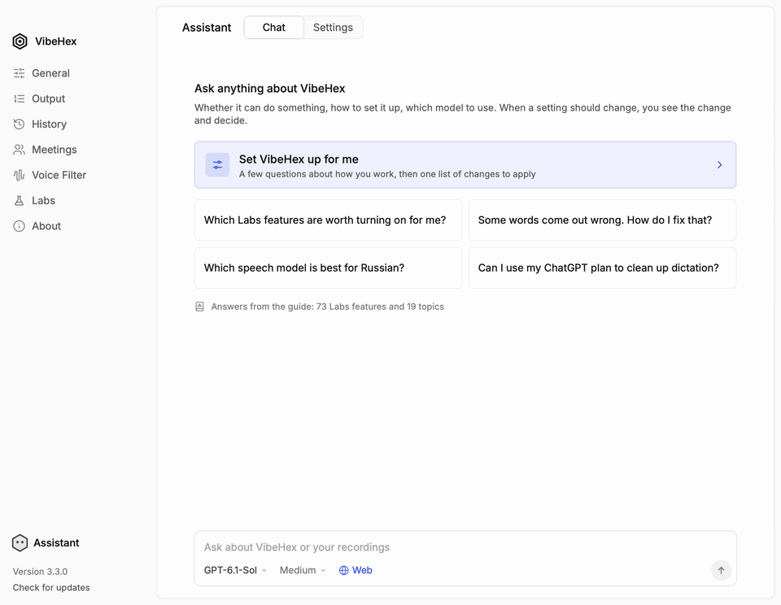
</picture>

**Set VibeHex up for me.** A few questions about how you work, then one list
of changes: each says why it fits, untick what you don't need, apply them
together, and undo if you change your mind.

VibeHex is built for people who dictate to code and to AI assistants. Hold a
key, speak, and it pastes. It is a fork of [Hex](https://github.com/anomalyco/hex)
by Anomaly: everything Hex does, VibeHex does too, and it keeps up with Hex's
changes. VibeHex is its own app, built and signed separately, so it is not an
official Hex release.

## What VibeHex adds to Hex

- **An assistant inside the app.** Ask in your own words how to do
  something. It answers from the app's guide with links to the exact
  setting, and offers changes as cards you apply with one click and can undo.
- **Setup in a few questions.** Tell it how you work, and it turns your
  answers into one list of changes, each with the reason it fits.
- **Answers from your recordings.** Ask about your meetings, files and
  dictations; each point links to the line it came from.
- **AI cleanup with no server.** A cleanup model runs inside VibeHex,
  offline, and you see its speed, quality and memory before you download it.
  Or clean up on Codex with your ChatGPT plan, OpenRouter, or your own server.
- **Fix a word from any app.** Select a misheard word, press a shortcut and
  type the right spelling: it goes into Vocabulary and is replaced in place.
- **Files.** Drop audio or video to transcribe it, clean it up, and rework
  the text with your own requests.
- **Meetings you can ask and listen to.** Questions in a Requests tab, notes
  even without Apple Intelligence, and playback from the transcript with the
  playing line lit.
- **Quiet while you dictate, even on a monitor.** Music and other apps get
  quieter even when macOS can't set your display's volume.

## Assistant

Ask in your own words how to do something. Answers come from VibeHex's guide,
with links straight to the setting, and changes come as cards you apply with
one click and can undo. It also helps you pick your shortcuts and tells you
what's new after an update. It runs on Codex with your ChatGPT plan
(recommended), OpenCode, OpenRouter, your own server, or a model built into
the app.

<picture>
  <source media="(prefers-color-scheme: dark)" srcset="docs/images/readme/assistant-answer-dark.gif">
  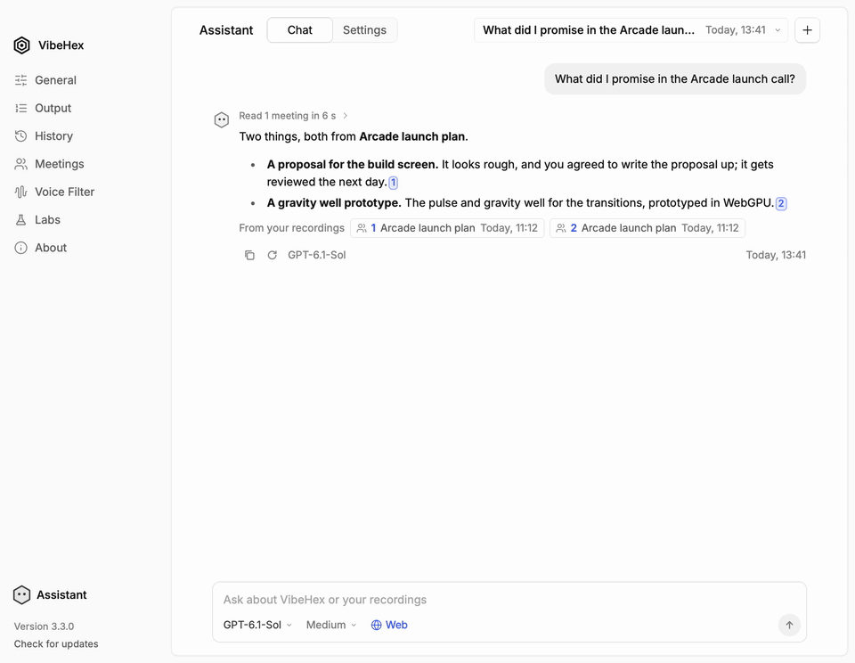
</picture>

**Answers that show their source.** With your permission it answers about
your meetings, files and dictations, and each number opens the recording on
the line it came from.

## Meetings and files

Ask questions about a meeting in its Requests tab. Notes are written even
when Apple Intelligence is off, and the transcript can be cleaned up turn by
turn. Yandex Telemost is detected alongside Zoom, Meet and the rest. Drop
audio and video files to transcribe them, clean them up, and rework the text
with your own requests.

<picture>
  <source media="(prefers-color-scheme: dark)" srcset="docs/images/readme/meetings-follow-dark.gif">
  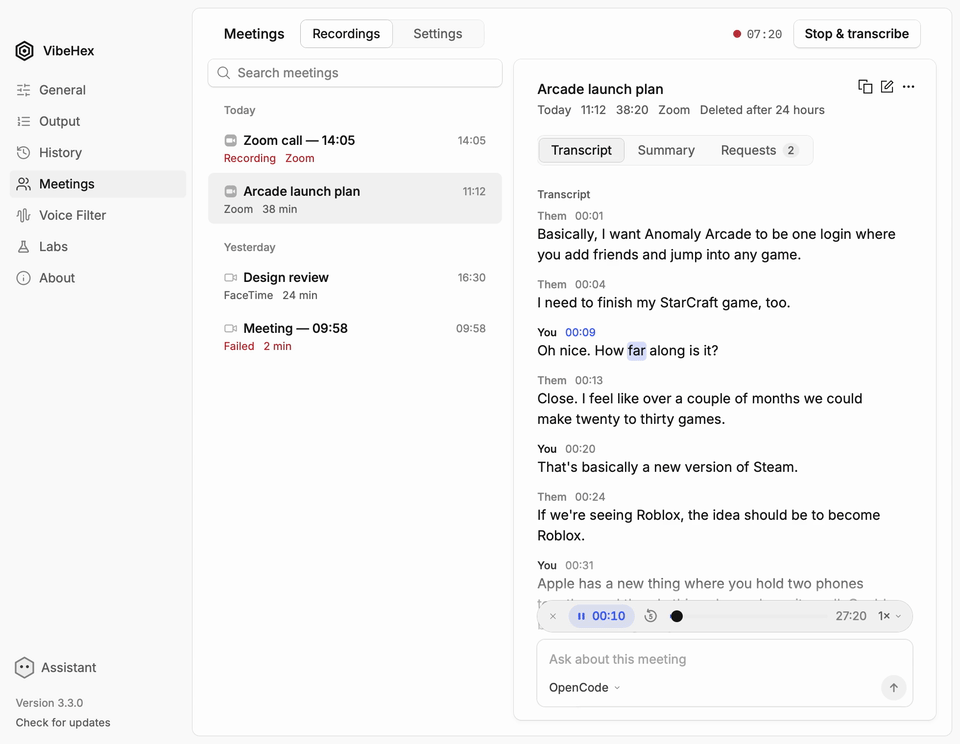
</picture>

**Listen from the transcript.** The line playing lights up; click any line to
play from there. Works for meetings and files.

## AI cleanup and vocabulary

- **Cleanup with no setup.** Download a cleanup model and VibeHex runs it
  inside the app, with no server or API key. It can also run on OpenRouter,
  your own server such as LM Studio or Ollama, or Codex with your ChatGPT
  plan. A long dictation is cleaned in pieces; a bar in place of the HUD
  shows the progress, and Paste now pastes what is ready.
- **Technical words come out right.** Russian vibe coding adds 80 terms such
  as Claude Code, GitHub and MCP, fixes for words that often come out wrong
  in Russian, and cleanup instructions, all in one switch.
- **Fix a word where you see it.** Select a word that came out wrong in any
  app and press a shortcut: it goes into Vocabulary with the right spelling
  and is replaced where you selected it.

<picture>
  <source media="(prefers-color-scheme: dark)" srcset="docs/images/readme/quick-add-dark.gif">
  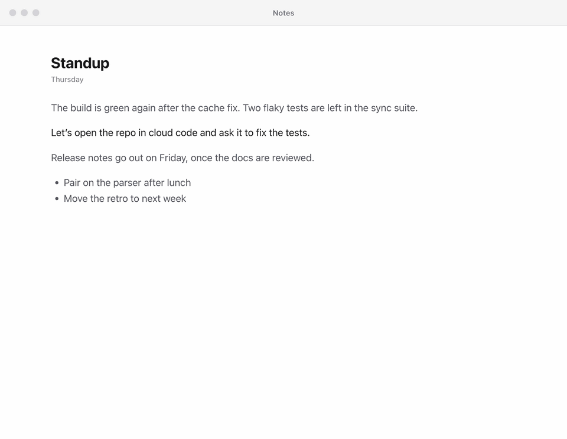
</picture>

**Labs › Add to vocabulary from a selection.** Select the misheard words in
any app and press Option+Shift+A (the default shortcut), type the right
spelling, then Add.

## Small things that add up

- **Quiet while you dictate, even on a monitor.** Mute and Lower audio also
  work when macOS can't set your output's volume, as with a display's
  speakers. They lower Music and Spotify, or, with Lower every app on, every
  app.
- A separate key, such as Return, can finish a dictation.
- Every update shows what changed, including the releases you skipped.
- Everything VibeHex adds is translated into Russian, like the rest of the
  interface.

<picture>
  <source media="(prefers-color-scheme: dark)" srcset="docs/images/readme/sidebar-fold-dark.gif">
  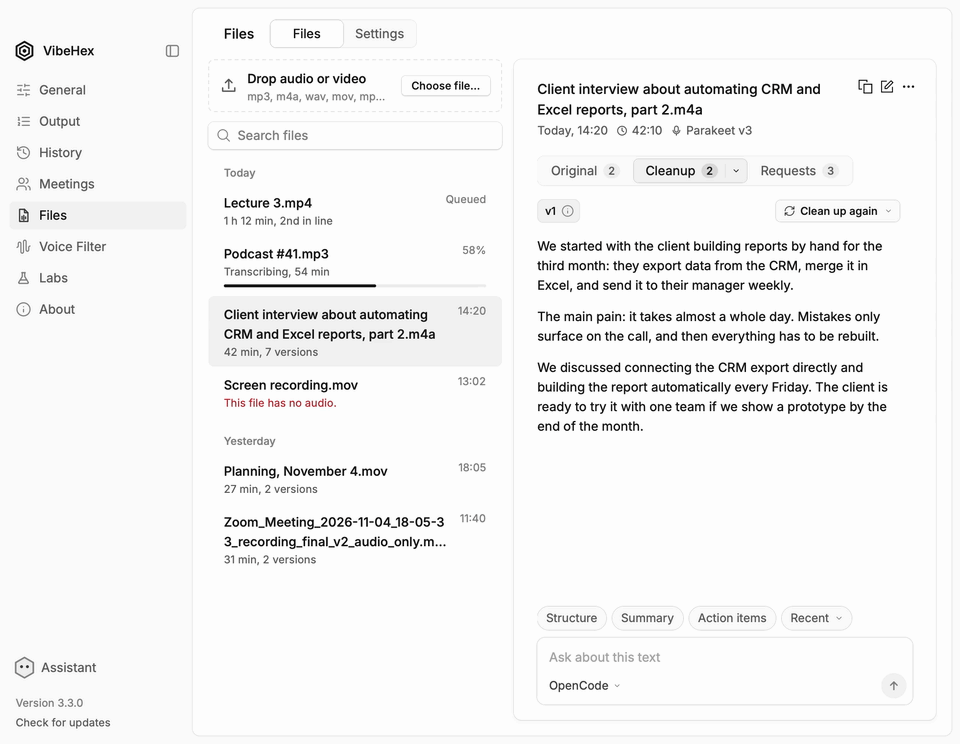
</picture>

**The sidebar folds.** Turn on Labs › Collapsible sidebar, and a button by
the logo folds the sidebar into a column of icons.

Most of what VibeHex adds lives in Labs, marked with a star, and stays off
until you turn it on. Russian vibe coding turns on most of it in one go.

## Screenshots

<table>
<tr>
<td width="50%" valign="top">
<a href="docs/images/readme/cleanup-built-in-dark.png">
<picture>
  <source media="(prefers-color-scheme: dark)" srcset="docs/images/readme/cleanup-built-in-dark.png">
  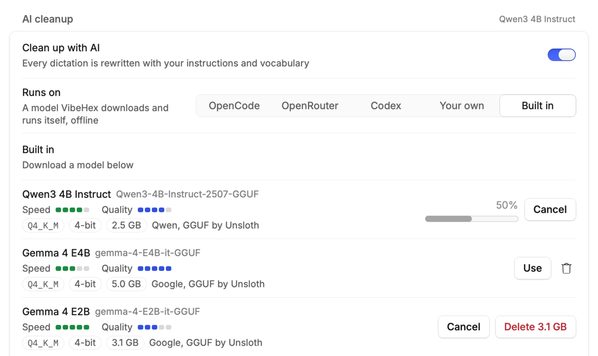
</picture>
</a>
 <b>AI cleanup, built in.</b> Download a model and VibeHex runs it offline. Each one shows its speed and quality.
</td>
<td width="50%" valign="top">
<a href="docs/images/readme/cleanup-codex-dark.png">
<picture>
  <source media="(prefers-color-scheme: dark)" srcset="docs/images/readme/cleanup-codex-dark.png">
  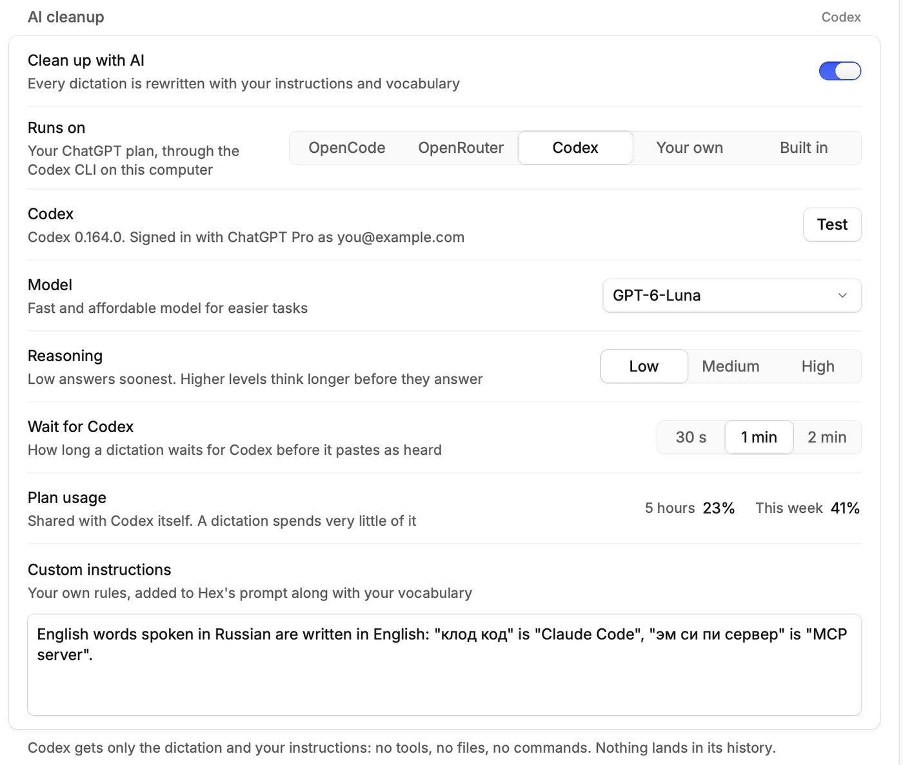
</picture>
</a>
 <b>AI cleanup on Codex.</b> Your ChatGPT plan through the Codex CLI, with the model, reasoning and plan usage in view.
</td>
</tr>
<tr>
<td width="50%" valign="top">
<a href="docs/images/readme/files-dark.png">
<picture>
  <source media="(prefers-color-scheme: dark)" srcset="docs/images/readme/files-dark.png">
  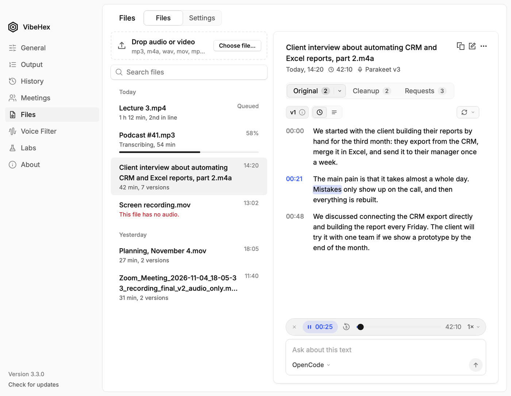
</picture>
</a>
 <b>Files.</b> Drop audio or video to transcribe it, play it from the text, and rework it with your own requests.
</td>
<td width="50%" valign="top">
<a href="docs/images/readme/meetings-requests-dark.png">
<picture>
  <source media="(prefers-color-scheme: dark)" srcset="docs/images/readme/meetings-requests-dark.png">
  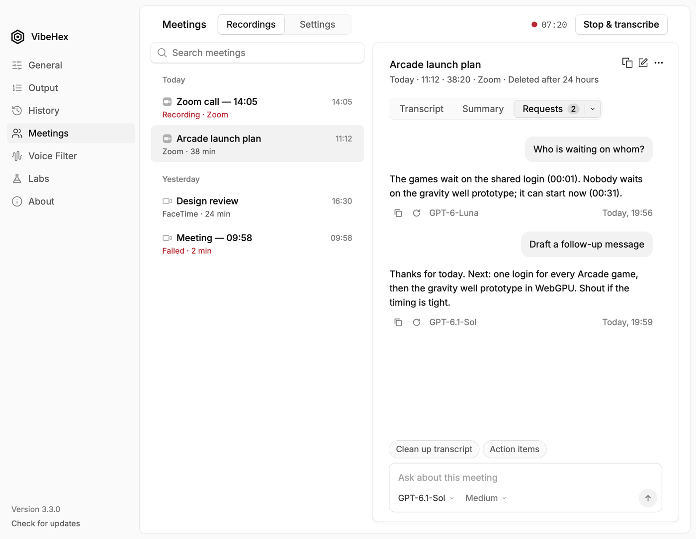
</picture>
</a>
 <b>Requests.</b> Ask about a meeting and keep the answers in its Requests tab.
</td>
</tr>
<tr>
<td width="50%" valign="top">
<a href="docs/images/readme/vocabulary-dark.png">
<picture>
  <source media="(prefers-color-scheme: dark)" srcset="docs/images/readme/vocabulary-dark.png">
  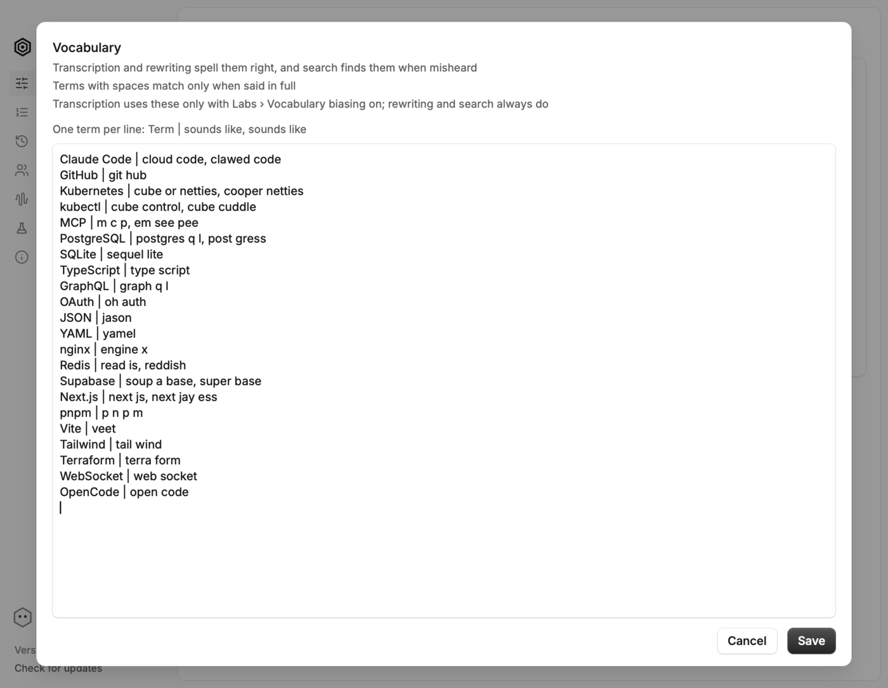
</picture>
</a>
 <b>Vocabulary.</b> Text view (Labs): one term per line, with how it sounds when misheard.
</td>
<td width="50%" valign="top">
<a href="docs/images/readme/labs-dark.png">
<picture>
  <source media="(prefers-color-scheme: dark)" srcset="docs/images/readme/labs-dark.png">
  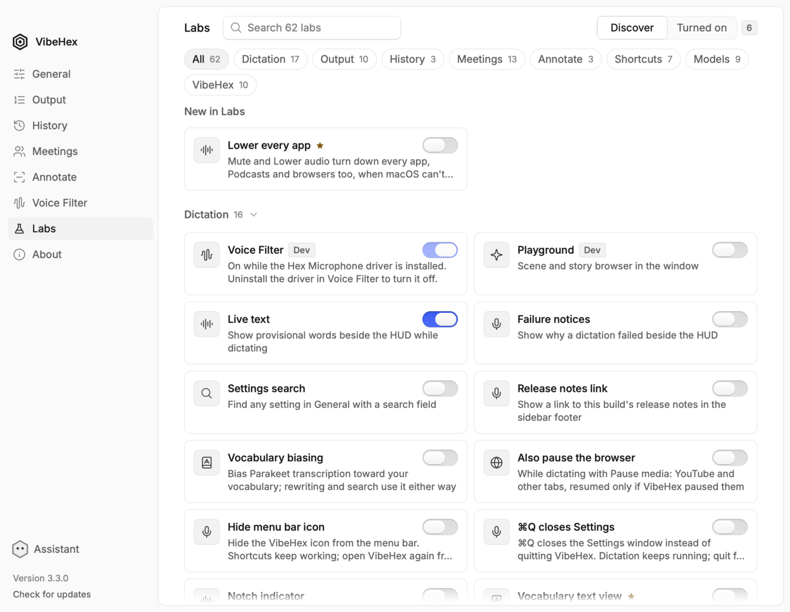
</picture>
</a>
 <b>Labs.</b> What VibeHex adds is marked with a star, and new features are listed first.
</td>
</tr>
</table>

## How it works

- hold the shortcut, speak, then let go
- VibeHex transcribes on your Mac and pastes into whatever app you're in
- the first run asks which speech model to download; after that nothing leaves your Mac
  unless you choose a cloud engine for cleanup
- experimental features live in Labs, at the bottom of the sidebar

## Download

VibeHex runs on macOS 15 or later on Apple silicon. There are no Windows or
Linux builds.

Get the DMG from the [latest release](https://github.com/makeaiwork/VibeHex/releases/latest)
and drag VibeHex to Applications. It updates itself after that, and each
update lists what changed.

VibeHex is a separate app from Hex: macOS asks for Microphone and
Accessibility access again. Settings, History, Vocabulary and models are
shared with Hex, since both use the same data folder. Run one of them at a
time.

More docs are in [`docs/`](docs/README.md).

## License

MIT, as Hex is.
