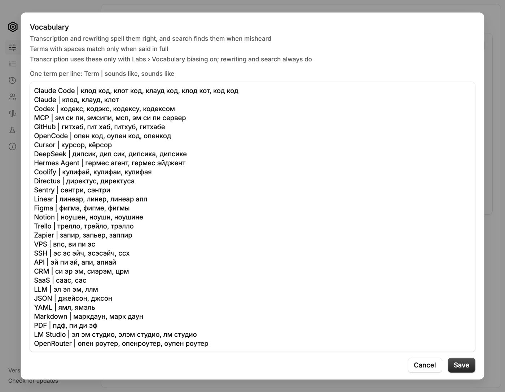

# VibeHex

VibeHex is local voice dictation for macOS, built for people who dictate to
code and to AI assistants. Hold a key, speak, and it pastes.

It is a fork of [Hex](https://github.com/anomalyco/hex) by Anomaly. Everything
Hex does, VibeHex does too, and it keeps up with Hex's changes. On top of that
it adds vocabulary tools, AI cleanup without a separate server, files and
meetings you can work with, and a Russian setup for vibe coding. VibeHex is
its own app, built and signed separately, so it is not an official Hex
release.

## Why VibeHex

- **Technical words come out right.** Russian vibe coding adds 80 terms such
  as Claude Code, GitHub and MCP, fixes for words that often come out wrong in
  Russian, and cleanup instructions, all in one switch. When a word comes out
  wrong, select it in any app and press a shortcut: it goes into Vocabulary
  with the right spelling and is replaced where you selected it. Vocabulary
  also opens as plain text, one term per line, to paste or fix many terms at
  once.
- **AI cleanup with no setup.** Download a cleanup model and VibeHex runs it
  inside the app, with no server or API key. Each model shows its speed and
  quality before you pick it. If you prefer, cleanup can also run on
  OpenRouter, on your own server such as LM Studio or Ollama, or on Codex with
  your ChatGPT plan. A long dictation is cleaned in pieces; a bar in place of
  the HUD shows the progress, and Paste now pastes what is ready.
- **Files.** Drop audio and video files to transcribe them, clean them up, and
  rework the text with your own requests.
- **Meetings you can ask about.** Ask questions about a meeting in a Requests
  tab. Notes are written even when Apple Intelligence is off, and the
  transcript can be cleaned up turn by turn. Listen to a meeting or a file
  from its transcript: the line playing lights up, and a click on a line plays
  from there. Yandex Telemost is detected alongside Zoom, Meet and the rest.
- **Quiet while you dictate, even on a monitor.** Mute and Lower audio also
  work when macOS can't set your output's volume, as with a display's
  speakers. They lower Music and Spotify, or, with Lower every app on, every
  app.
- **Small things that add up.** A separate key, such as Return, can finish a
  dictation. The sidebar folds into a column of icons. Every update shows what
  changed, including the releases you skipped. Everything VibeHex adds is
  translated into Russian, like the rest of the interface.

Most of these live in Labs, marked with a star, and stay off until you turn
them on. Russian vibe coding turns on most of them in one go.

## Screenshots

**Files.** A transcript you can play: the line playing lights up, and you can ask about the text below it.

<picture>
  <source media="(prefers-color-scheme: dark)" srcset="docs/images/readme/files-dark.png">
  
</picture>

**Meetings.** Ask about a meeting and keep the answers in its Requests tab.

<picture>
  <source media="(prefers-color-scheme: dark)" srcset="docs/images/readme/meetings-requests-dark.png">
  
</picture>

**AI cleanup, built in.** Download a model and VibeHex runs it itself, offline. Each one shows its speed and quality.

<picture>
  <source media="(prefers-color-scheme: dark)" srcset="docs/images/readme/cleanup-built-in-dark.png">
  
</picture>

**AI cleanup on Codex.** Use your ChatGPT plan through the Codex CLI, with the model, reasoning and plan usage in view.

<picture>
  <source media="(prefers-color-scheme: dark)" srcset="docs/images/readme/cleanup-codex-dark.png">
  
</picture>

**Vocabulary as text.** One term per line, with how it sounds when misheard.

<picture>
  <source media="(prefers-color-scheme: dark)" srcset="docs/images/readme/vocabulary-text-dark.png">
  
</picture>

**Labs.** What VibeHex adds is marked with a star, and new features are listed first.

<picture>
  <source media="(prefers-color-scheme: dark)" srcset="docs/images/readme/labs-dark.png">
  
</picture>

## How it works

- hold the shortcut, speak, then let go
- VibeHex transcribes on your Mac and pastes into whatever app you're in
- the first run downloads a speech model; after that nothing leaves your Mac
  unless you choose a cloud engine for cleanup
- experimental features live in Labs, at the bottom of the sidebar

## Download

VibeHex runs on macOS 15 or later on Apple silicon. There are no Windows or
Linux builds.

Get the DMG from the [latest release](https://github.com/makeaiwork/VibeHex/releases/latest)
and drag VibeHex to Applications. It updates itself after that, and each
update lists what changed.

VibeHex is a separate app from Hex: macOS asks for Microphone and
Accessibility access again. Settings, History, Vocabulary and models are
shared with Hex, since both use the same data folder. Run one of them at a
time.

More docs are in [`docs/`](docs/README.md).

## License

MIT, as Hex is.
